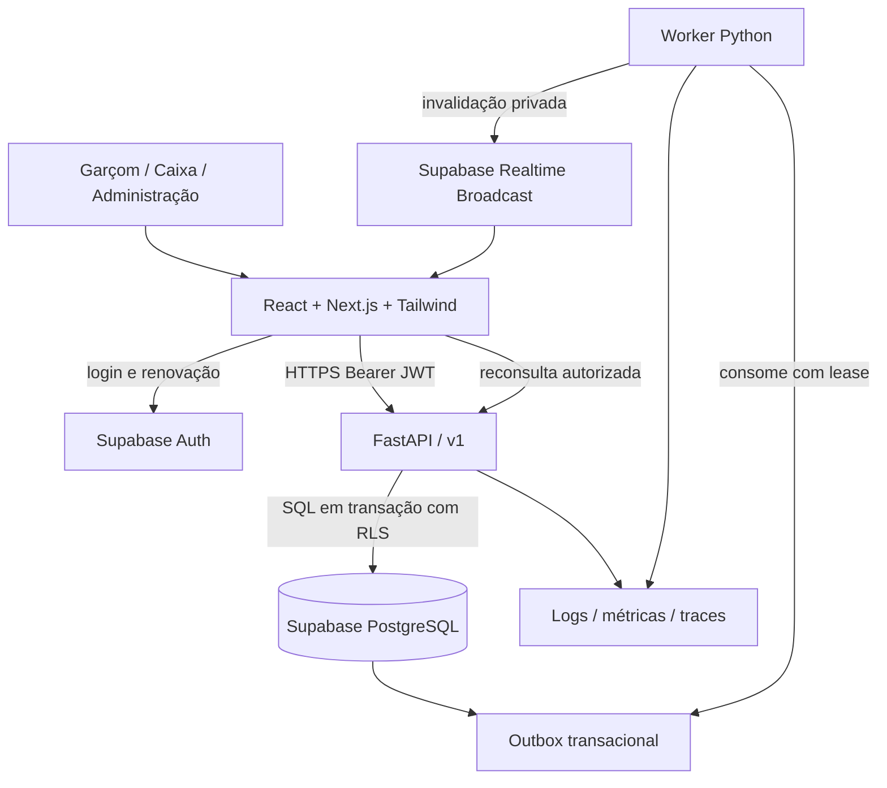

# Comandei — Documentação técnica

**Versão:** 1.0 • **Data:** 26/10/2026 • **Status:** proposta de arquitetura para implementação.

**Público:** produto, desenvolvimento, QA e operação. Este documento define o comportamento esperado; não representa um sistema já implementado ou homologado. O [roadmap](02-roadmap-implementacao-comandei.md) transforma estas decisões em trabalho verificável.

## Sumário

1. Produto, escopo e premissas
2. Perfis e experiência responsiva
3. Arquitetura e decisões
4. Multi-tenancy
5. Autenticação, autorização e RLS
6. Modelo de dados
7. Pedidos, comandas e concorrência
8. Valores, pagamentos e caixa
9. Contrato da API
10. Sincronização e conectividade
11. Frontend e organização do código
12. Segurança operacional e dados pessoais
13. Observabilidade e metas
14. Estratégia de testes
15. Ambientes, deploy e recuperação
16. Evolução do SaaS e decisões pendentes
17. Referências

## 1. Produto, escopo e premissas

O Comandei será um SaaS online para registrar o consumo de restaurantes, acompanhar pedidos, receber pagamentos e controlar o fechamento de comandas e turnos de caixa. A aplicação web responsiva atende celular, tablet e PC com a mesma base de código.

### 1.1 MVP operacional

- Login individual, recuperação de acesso, convites e seleção de restaurante.
- Administração de equipe, mesas, categorias, produtos, preços e indisponibilidade.
- Abertura de comandas de mesa ou de balcão; vários pedidos por comanda.
- Lançamento de produtos com quantidade, adicionais e observações.
- Envio, acompanhamento e cancelamento controlado de itens.
- Pré-conta, desconto autorizado, taxa de serviço opcional e pagamentos parciais por valor.
- Registro manual de dinheiro, cartão e Pix recebidos fora do sistema.
- Abertura e fechamento de turno de caixa, suprimentos, sangrias e divergências.
- Atualização entre dispositivos, histórico de operações, relatórios diários e exportação CSV.
- Onboarding assistido e controle básico de situação e limites do cliente SaaS.

### 1.2 Evoluções fora do MVP

Cobrança automática da assinatura SaaS; integração Pix/cartão com provedor; NFC-e/NF-e e integrações contábeis; TEF; impressão térmica automática; divisão por item/pessoa; transferência e união de comandas; estoque por ficha técnica; delivery; autosserviço por QR Code; múltiplas filiais dentro de um tenant; operação offline com gravação; aplicativo nativo ou Electron.

A pré-conta e o recibo operacional são identificados como não fiscais. Requisitos fiscais, de privacidade e de pagamento devem passar por análise específica antes dessas integrações. Não se pressupõe que um registro manual confirme uma transação bancária.

### 1.3 Premissas de planejamento

| Tema | Decisão inicial |
|---|---|
| Tenant | Um estabelecimento operacional, com moeda BRL e fuso configurável |
| Grupo com várias lojas | Um tenant por loja no MVP; usuário pode participar de várias lojas |
| Conectividade | Internet necessária para confirmar qualquer operação |
| Horários | Persistência em UTC; exibição e dia operacional no fuso do restaurante |
| Comanda por mesa | No máximo uma comanda ativa por mesa; balcão permite várias |
| Garçons | Podem colaborar nas comandas do restaurante; autoria de cada operação é preservada |
| Pagamentos | Múltiplos pagamentos por valor; sem rateio por item no MVP |
| Capacidade inicial a validar | 20 restaurantes × 25 sessões simultâneas; não é capacidade comprovada |

## 2. Perfis e experiência responsiva

### 2.1 Matriz de permissões

Os nomes abaixo são papéis do produto, distintos dos roles técnicos do PostgreSQL. Todos operam somente nos tenants em que têm vínculo ativo.

| Ação | Garçom | Caixa | Gerente | Proprietário |
|---|---|---|---|---|
| Consultar mesas, cardápio e comandas | Sim | Sim | Sim | Sim |
| Abrir comanda e lançar/enviar itens | Sim | Sim | Sim | Sim |
| Cancelar item enviado, com motivo | Solicitar | Solicitar | Autorizar | Autorizar |
| Consultar pré-conta | Sim | Sim | Sim | Sim |
| Iniciar fechamento, receber e encerrar | Não | Sim | Sim | Sim |
| Aplicar desconto | Não | Até limite configurado | Até limite configurado | Sim |
| Reabrir comanda sem recebimentos | Não | Não | Sim | Sim |
| Estornar recebimento | Não | Não | Sim | Sim |
| Abrir/fechar turno e movimentar caixa | Não | Próprio turno | Todos | Todos |
| Manter catálogo e mesas | Não | Não | Sim | Sim |
| Convidar equipe | Não | Não | Garçom/caixa | Todos |
| Gerenciar proprietário, plano e exportação completa | Não | Não | Não | Sim |

Desconto acima do limite exige aprovação de gerente/proprietário registrada pelo próprio aprovador autenticado. Nunca usar um campo `approved_by` preenchido pelo solicitante como prova de aprovação. Não permitir remover ou desativar o último proprietário ativo.

Administração da plataforma é uma área separada: provisionar clientes, acompanhar saúde, limites e situação comercial. Suporte não recebe acesso automático a comandas ou pagamentos. Acesso excepcional exige escopo, justificativa, prazo e auditoria; não existe papel global implícito no JWT comum.

### 2.2 Telas e critérios de usabilidade

| Área | Telas e comportamento |
|---|---|
| Acesso | Login, recuperação, convite, seleção de restaurante e sessão expirada |
| Garçom | Mesas em cartões, busca de produtos, carrinho local, revisão, envio e status |
| Caixa | Comandas abertas, detalhamento, pré-conta, recebimentos, troco e fechamento |
| Administração | Catálogo, adicionais, equipe, mesas, taxas, relatórios e auditoria |
| Plataforma | Lista de tenants, onboarding, limites e status da assinatura |

Validar larguras de 360, 768 e 1366 px, orientação retrato/paisagem e zoom de 200%. Botões principais têm alvo de toque de pelo menos 44 × 44 px. Formulários possuem rótulos, foco visível, erros associados e navegação por teclado. Status usam texto/ícone além de cor. Desabilitar repetição visual de envio ajuda a experiência, mas a API garante a idempotência.

No celular, priorizar mesa → produto → revisão → enviar, com resumo fixo do carrinho. No PC, usar lista e detalhe lado a lado, atalhos documentados e confirmação explícita antes de receber/estornar. O tablet adapta a composição conforme espaço disponível. Tailwind fornece os recursos responsivos; a seleção dos breakpoints pertence ao design do produto. [Documentação Tailwind](https://tailwindcss.com/docs/responsive-design).

## 3. Arquitetura e decisões

### 3.1 Visão de componentes



### 3.2 Responsabilidades

| Componente | Responsabilidade |
|---|---|
| React + Next.js App Router | Rotas, layouts, renderização, componentes interativos e adaptação por dispositivo |
| Tailwind CSS | Tokens visuais, responsividade e estilos consistentes |
| FastAPI | Validação, autorização, cálculo financeiro, transações, relatórios e OpenAPI |
| Supabase Auth | Identidade, login, recuperação, renovação e MFA quando exigido |
| PostgreSQL | Dados, constraints, RLS, integridade, bloqueios e auditoria transacional |
| Supabase Realtime | Avisos de atualização para clientes autorizados |
| Worker Python | Entrega durável dos avisos, exportações e tarefas de reconciliação |

**ADR-01 — Web responsiva com preparação para PWA.** Uma aplicação atende todos os dispositivos previstos. Manifesto e instalação podem ser adicionados; cache offline de operações financeiras fica fora do MVP.

**ADR-02 — Monólito modular FastAPI.** Módulos de identidade, tenancy, catálogo, atendimento, pagamentos, caixa, relatórios e plataforma. Uma implantação da API e um processo worker; não criar microserviços inicialmente.

**ADR-03 — Escritas de negócio exclusivamente pelo FastAPI.** O browser acessa Auth e Realtime diretamente, mas não recebe grants de escrita nas tabelas operacionais. Next.js não repete regras de negócio em Server Actions ou Route Handlers. Uma ação de servidor que existir chama a API e continua exigindo autorização. [Segurança no Next.js](https://nextjs.org/docs/app/guides/data-security).

**ADR-04 — SQL direto com credencial restrita.** FastAPI usa SQLAlchemy 2 e driver PostgreSQL compatível, DTOs Pydantic e conexão TLS. A conexão não é feita como `postgres`, proprietário das tabelas ou role com `BYPASSRLS`. RLS não é acionada automaticamente pelo JWT ao usar SQL direto: a API estabelece o contexto verificado em cada transação.

**ADR-05 — Outbox e Broadcast privado.** Eventos são sinais de invalidação; a API continua sendo fonte de dados e autorização. Não expor registros financeiros completos por WebSocket.

Versões exatas de React, Next.js, Tailwind, Python, FastAPI e SDKs serão fixadas na fase 0, com lockfiles e matriz de compatibilidade. Registrar versões reais do PostgreSQL e das extensões do projeto. Exemplos aqui são contratos de referência, não migrations prontas para produção.

## 4. Multi-tenancy

### 4.1 Isolamento

Usar um projeto Supabase por ambiente e banco compartilhado com schema compartilhado. Todas as entidades de restaurante carregam `tenant_id NOT NULL`. `tenants` e identidade global são exceções explícitas. Nunca derivar autorização apenas de subdomínio, URL, header, UUID imprevisível ou item selecionado na interface.

O identificador vem da rota `/v1/tenants/{tenant_id}/...`, é validado contra o vínculo atual do usuário e é fixado no contexto transacional. O body não pode sobrescrevê-lo. Consultas, caches, arquivos, jobs, auditoria, limites e exportações incluem esse escopo. Trocar restaurante encerra canais e limpa caches/rascunhos do tenant anterior.

Chaves estrangeiras de negócio são compostas: `(tenant_id, comanda_id)` referencia `(tenant_id, id)` de `tabs`. Isso impede vincular um item do restaurante A à comanda B mesmo se houver erro na API. Para cada tabela referenciada, criar `UNIQUE (tenant_id, id)` além da chave primária UUID. Unicidades de nome, número ou código são locais ao tenant.

### 4.2 Limites e vizinhos ruidosos

Manter `tenant_entitlements` com limites de usuários, mesas e recursos. Aplicar limites no servidor, sem impedir consulta e recebimento de contas em andamento por uma suspensão comercial durante o turno. Política proposta: restringir novas operações após período de tolerância e permitir encerramento assistido; validar comercialmente na fase 0.

Aplicar rate limit por usuário/tenant e limites de exportação. Medir consumo por tenant, mas evitar `tenant_id` como label em todas as métricas para não gerar cardinalidade excessiva. Uma futura separação de clientes grandes em bancos dedicados deve preservar o contrato da API; não faz parte do MVP.

## 5. Autenticação, autorização e RLS

### 5.1 Sessão

1. Usuário autentica no Supabase Auth com e-mail/senha; conta individual, sem login compartilhado por turno.
2. Next.js usa `@supabase/ssr` quando a sessão precisa estar disponível no servidor, com clients separados de browser e servidor. Renovação segue a convenção da versão fixada: `proxy.ts` nas versões atuais que usam Proxy, `middleware.ts` nas anteriores. [Guia SSR](https://supabase.com/docs/guides/auth/server-side/creating-a-client?queryGroups=framework&framework=nextjs).
3. Browser envia access token no header `Authorization: Bearer`; refresh token nunca vai para o FastAPI nem para logs. O fluxo SDK/SSR precisa ser testado em múltiplas abas, pois parte da sessão é acessível ao cliente e depende de proteção contra XSS.
4. FastAPI valida assinatura com JWKS de URL fixa do projeto, algoritmo permitido, `iss`, `aud` configurada, `exp`, `nbf` quando presente e `sub` UUID. JWT decodificado sem validação não autentica. Cachear JWKS com prazo e atualização controlada em rotação de `kid`; falhar fechado em chave desconhecida. [Verificação JWT Supabase](https://supabase.com/docs/guides/auth/jwts).
5. Confirmar vínculo ativo em banco em toda requisição. Papel/tenant não vêm de `user_metadata`. Mudança de papel ou desativação passa a valer na próxima operação autorizada, sem esperar atualização de claims.
6. Em estornos, mudança de proprietário e administração sensível, exigir autenticação recente/MFA e verificar sessão ativa segundo o mecanismo suportado pelo Auth. Revogar uma sessão não torna toda verificação criptográfica local de JWT uma consulta de revogação.

O FastAPI aceita a identidade do Supabase; não implementa um segundo emissor de tokens nem armazena senhas. Dependências de segurança extraem credenciais e aplicam permissões; a autenticação por JWT precisa de verificação real e tratamento explícito de erro. [Segurança FastAPI](https://fastapi.tiangolo.com/tutorial/security/oauth2-jwt/).

### 5.2 Pipeline de autorização FastAPI

```text
HTTPBearer
 → verify_supabase_access_token
 → begin_transaction + set_local_verified_context
 → require_active_membership(tenant_id)
 → require_permission(action)
 → load_resource_inside_tenant
 → validate_state_and_approval
 → service + audit + outbox
 → commit
```

Cada endpoint possui ação explícita, como `orders.submit`, `payments.record` ou `members.invite`. O repository exige contexto de tenant; não oferecer consultas de negócio globais por padrão. Recursos de outro tenant retornam 404; falta de papel em recurso visível retorna 403. Autorização de ação ocorre antes de qualquer mutação.

Papéis do PostgreSQL:

- `comandei_owner`: migrations, separado do runtime e sem uso no app.
- `comandei_api`: login restrito, não proprietário, sem `BYPASSRLS`, com grants mínimos por tabela.
- `comandei_worker`: somente operações necessárias a jobs/outbox e funções específicas.
- `authenticated`: identidade técnica de clientes Supabase; somente acesso mínimo para autorizar canais, sem DML operacional.

O runtime não pode criar objetos, alterar grants/policies, assumir o proprietário ou executar SQL fornecido por usuários. Uma credencial SQL comprometida continua sendo um incidente grave: o contexto customizado é confiável porque só o backend verificado o define, e não é uma fronteira contra o próprio backend comprometido.

### 5.3 Schemas e política de referência

Guardar negócio em schema `app`, fora dos schemas expostos na Data API. RLS também é habilitada ali como segunda camada. Revogar grants legados de `anon`/`authenticated` sobre tabelas de negócio. Grants e RLS são controles diferentes. [RLS Supabase](https://supabase.com/docs/guides/database/postgres/row-level-security).

Exemplo conceitual para `tabs`, após criar tabelas e roles. O vínculo possui política própria para impedir recursão. Este trecho precisa ser expandido, migrado e testado para cada entidade.

```sql
-- Contexto definido com parâmetros vinculados, dentro da mesma transação SQL:
select set_config('app.user_id', :verified_user_id, true);
select set_config('app.tenant_id', :authorized_tenant_id, true);

-- member lookup: comandei_api só enxerga vínculos do próprio usuário.
alter table app.memberships enable row level security;
alter table app.memberships force row level security;
create policy membership_self_api on app.memberships
for select to comandei_api
using (
  user_id = nullif(current_setting('app.user_id', true), '')::uuid
);

alter table app.tabs enable row level security;
alter table app.tabs force row level security;
create policy tabs_tenant_api on app.tabs
for all to comandei_api
using (
  tenant_id = nullif(current_setting('app.tenant_id', true), '')::uuid
  and exists (
    select 1 from app.memberships m
    where m.tenant_id = tabs.tenant_id
      and m.user_id = nullif(current_setting('app.user_id', true), '')::uuid
      and m.status = 'active'
  )
)
with check (
  tenant_id = nullif(current_setting('app.tenant_id', true), '')::uuid
  and exists (
    select 1 from app.memberships m
    where m.tenant_id = tabs.tenant_id
      and m.user_id = nullif(current_setting('app.user_id', true), '')::uuid
      and m.status = 'active'
  )
);
```

A política acima isola tenant e vínculo; a matriz de ações continua obrigatória no FastAPI. Restringir colunas imutáveis (`tenant_id`, autoria, snapshots) por grants/triggers e permissões de repository. Criar policies adicionais específicas para manutenção de membros: a consulta do próprio vínculo não autoriza gerenciar equipe. Provisionamento e convite usam operação administrativa estreita, com validação de ator e tenant; não conceder DML irrestrito de memberships ao runtime. Preferir funções `SECURITY INVOKER`; exceções `SECURITY DEFINER` ficam em schema não exposto, com `search_path` fixo, nomes qualificados, `EXECUTE` revogado de `PUBLIC` e grants específicos.

Superusuários e roles `BYPASSRLS` contornam RLS; proprietários normalmente também a contornam, salvo `FORCE ROW LEVEL SECURITY`. Testes devem usar o role real do runtime, não apenas o proprietário. [Regras PostgreSQL](https://www.postgresql.org/docs/current/ddl-rowsecurity.html).

### 5.4 Pool de conexões

`set_config(..., true)` tem escopo local à transação. Abrir transação antes de configurar contexto, executar todas as consultas nela e concluir com commit/rollback. Não usar `SET` de sessão para usuário/tenant; o pool poderia reutilizar uma conexão contaminada. Testar A → B na mesma conexão e exceção → rollback → B.

Selecionar pooler de sessão ou transação conforme o runtime e validar prepared statements com o driver escolhido. Somar pools de todas as réplicas e workers, reservar conexões administrativas e estabelecer limites/timeout. Nunca criar um pool por requisição. [Conexões Supabase](https://supabase.com/docs/guides/database/connecting-to-postgres).

## 6. Modelo de dados

### 6.1 Convenções

UUID para identificadores; `created_at`/`updated_at` em `timestamptz`; valores monetários inteiros em centavos (`bigint`, validados contra limites do produto); percentuais em pontos-base; quantidade `numeric(12,3)` para produtos fracionados. Produtos unitários exigem quantidade inteira. No contrato JSON, quantidades decimais são strings e valores em centavos respeitam o intervalo inteiro seguro do JavaScript.

Usar constraints para quantidades positivas, totais não negativos, estados válidos e referências. Relatórios usam `business_date`/turno e fuso do estabelecimento, sem cortar uma operação da madrugada pelo fuso do servidor. Dados operacionais cancelados são preservados; catálogo usa desativação. Não aplicar `ON DELETE CASCADE` a histórico financeiro.

### 6.2 Dicionário principal

Campos `id`, `tenant_id` e timestamps são implícitos nas tabelas de negócio, exceto quando indicado.

| Tabela | Campos essenciais e finalidade |
|---|---|
| `tenants` | `id`, nome, slug único global, timezone, currency, status, business_day_cutoff |
| `profiles` | `user_id` → `auth.users`, nome de exibição; identidade global mínima |
| `memberships` | `tenant_id`, `user_id`, role, status, invited_by; unique tenant/usuário |
| `invitations` | e-mail normalizado, role permitido, token hash, expiração, consumed_at |
| `tenant_entitlements` | plano, limites, recursos habilitados, vigência, status comercial |
| `dining_tables` | código, nome, capacidade, active; unique tenant/código |
| `categories` | nome, posição, active |
| `products` | categoria, sku, nome, preço em centavos, unidade, available, active, version |
| `modifier_groups` | nome, mínimo/máximo de escolhas; vínculos com produtos |
| `modifier_options` | grupo, nome, adicional em centavos, active |
| `product_modifier_groups` | produto/grupo e ordem; todas as referências no mesmo tenant |
| `tabs` | table_id nullable, número local, status, opened_by, closed_by, version, business_date |
| `orders` | tab_id, sequence, status derivado, submitted_by, submitted_at, version |
| `order_items` | order_id, product_id, nome/preço/unidade snapshot, quantity, notes, status, version |
| `order_item_modifiers` | item_id, opção original, nome/preço snapshot e quantidade |
| `adjustments` | tab_id, tipo desconto/serviço, base, regra snapshot, valor, motivo, requested_by, approved_by |
| `approval_requests` | ação, recurso, versão esperada, payload/hash imutável, solicitante, estado, aprovador, expiração; aprovação executa uma única ação vinculada |
| `tab_settlements` | tab_id, revisão, subtotal, descontos, serviço, total congelado, status |
| `payment_entries` | tab_id, settlement_id, cash_session_id, tipo recebimento/estorno, método, valor, estado, referência externa, original_entry_id |
| `cash_registers` | código e nome do terminal lógico de caixa |
| `cash_sessions` | register_id, operador, abertura, saldo inicial, encerramento, declarado, esperado, diferença |
| `cash_movements` | session_id, suprimento/sangria, valor, motivo, ator; sem duplicar recebimentos |
| `audit_events` | ator ou serviço, ação, recurso, resumo antes/depois sanitizado, motivo, request_id, occurred_at |
| `outbox_events` | event_id, tipo, aggregate_id, aggregate_version, payload mínimo, attempts, available_at, lease_until, delivered_at |
| `idempotency_records` | ator, endpoint, chave, hash do body, resultado, status HTTP, created_at, expires_at |
| `background_jobs` | tipo, estado, tentativas, lease, referência de resultado, erro sanitizado |

`payment_entries` no MVP representa registro operacional. Na integração futura, acrescentar `payment_intents` e `provider_events` com id externo único por provedor/conta. Cobrança da assinatura SaaS usa tabelas e rotas separadas das vendas do restaurante.

Campos de domínio complementam timestamps genéricos: `opened_at`/`closed_at` em comandas e turnos, `submitted_at` em pedidos, `occurred_at` em eventos. Aprovação tem uso único, expira e é invalidada se o recurso/valor mudar; aprovar e executar a ação ocorre atomicamente após revalidar permissões e versão. A mesma estrutura atende solicitação de cancelamento e desconto excedente.

### 6.3 Relações e restrições críticas

```text
auth.users 1──N memberships N──1 tenants
tenant 1──N tables / products / tabs / cash_registers
table 1──N tabs (apenas uma ativa por vez)
tab 1──N orders 1──N order_items 1──N item_modifiers
tab 1──N settlements 1──N payment_entries
cash_register 1──N cash_sessions 1──N payment_entries / cash_movements
```

Índices/constraints iniciais:

- `UNIQUE (tenant_id, user_id)` em memberships e índice `(user_id, status, tenant_id)`.
- `UNIQUE (tenant_id, id)` e FKs compostas em todos os vínculos entre tabelas de negócio.
- Índice único parcial em `tabs(tenant_id, table_id)` para `table_id IS NOT NULL AND status IN ('open','closing')`.
- Índice único parcial de turno ativo por `(tenant_id, register_id)`.
- `(tenant_id, status, opened_at)` em comandas; `(tenant_id, tab_id, submitted_at)` em pedidos.
- `(tenant_id, order_id)` em itens; `(tenant_id, tab_id, created_at)` em pagamentos.
- `UNIQUE (tenant_id, user_id, endpoint, key)` em idempotência; chave preservada em retries.
- Outbox pendente por `(available_at, created_at)` com predicado `delivered_at IS NULL`.
- Auditoria por `(tenant_id, occurred_at)`; catálogo por tenant/categoria/active.

Criar índices das FKs consultadas, verificar planos com `EXPLAIN (ANALYZE, BUFFERS)` em dados sintéticos e evitar índices especulativos. Política e filtro de tenant precisam aproveitar índices. Não particionar antes de medir volume e retenção.

## 7. Pedidos, comandas e concorrência

### 7.1 Estados e transições

| Entidade | Estados e regras |
|---|---|
| Comanda | `open → closing → closed`; `open → cancelled` somente sem consumo/recebimento; `closing → open` por gerente se não houver recebimento nem intenção pendente |
| Pedido | `submitted`, `in_progress`, `completed`, `cancelled`; derivado dos itens, sem edição independente |
| Item | `submitted → preparing → ready → delivered`; cancelamento autorizado em estados anteriores a delivered; delivered requer ajuste/estorno gerencial documentado |
| Liquidação | `active → settled` ou `superseded` antes de recebimentos; somente uma active por comanda |
| Recebimento manual | Inserção como `confirmed`; correção por nova entrada de estorno, sem sobrescrever a original |
| Turno | `open → closing → closed`; fechado não recebe novas movimentações |

O carrinho é rascunho local e não representa pedido aceito. O endpoint de envio cria pedido e itens em uma única transação. Depois de enviado, não editar preço/quantidade em silêncio: cancelar conforme política e lançar novo item. Uma futura cozinha poderá operar os estados de preparo; no MVP, gerente/caixa pode fazê-lo por permissão explícita e garçom marca entrega.

### 7.2 Fluxo de atendimento

1. Garçom consulta mesas e abre comanda; constraint resolve tentativas concorrentes de abrir a mesma mesa.
2. Seleciona produtos, adicionais e quantidade. A interface mostra preço conhecido e versão do catálogo.
3. Envia com chave idempotente. API valida vínculo, permissões, comanda aberta, disponibilidade e preço atual.
4. Se preço/versão mudou desde a revisão, retorna `409 PRICE_CHANGED` com cotação atual para nova confirmação; nunca cobrar valor enviado pelo browser.
5. API bloqueia a comanda, grava pedido/itens com snapshots, incrementa versão, grava auditoria/outbox e confirma.
6. Cliente mostra sucesso somente após resposta de commit. Em timeout, resultado é desconhecido: consultar/repetir a mesma chave.
7. Os demais dispositivos recebem sinal e reconsultam os dados autorizados.
8. Caixa inicia fechamento sob o mesmo lock usado no envio. Se envio ganhar, entra no total; se fechamento ganhar, novo envio recebe conflito e precisa revisão.

### 7.3 Concorrência

Para fechamento, recebimento, desconto e estorno, bloquear `tabs` com `SELECT ... FOR UPDATE` e, quando houver caixa, bloquear depois `cash_sessions`; adotar a mesma ordem em todos os fluxos. Operações que alteram saldo também adquirem o lock da comanda. Não manter transação aberta durante chamada a banco/provedor externo. [Locks PostgreSQL](https://www.postgresql.org/docs/current/explicit-locking.html).

`version` cresce monotonicamente por agregado. Alterações dependentes de uma leitura exigem `expected_version` e falham com 409 se estiver desatualizado. Locks serializam saldo; versões explicam o conflito ao operador. Limitar retries de deadlock/serialização com jitter e preservar idempotência.

Idempotência armazena hash e resposta na mesma transação da mutação. Mesma chave/body retorna o resultado original; chave com body diferente retorna `409 IDEMPOTENCY_MISMATCH`. Unicidade resolve duas requisições simultâneas. Prazo inicial: 7 dias para comandos comuns; referências únicas e histórico financeiro impedem duplicação permanente de transações financeiras, mesmo após expurgo do cache idempotente.

## 8. Valores, pagamentos e caixa

### 8.1 Regras de cálculo

```text
linha = arredondar_half_up(quantidade × (preço_unitário + adicionais_por_unidade))
subtotal = soma das linhas não canceladas
desconto = desconto autorizado, entre zero e subtotal
base_serviço = subtotal − desconto
serviço = arredondar_half_up(base_serviço × taxa_bps / 10000), se aceito
total = subtotal − desconto + serviço
recebido_líquido = recebimentos confirmados − estornos confirmados
saldo = total − recebido_líquido
```

Arredondar cada linha uma única vez; aplicar desconto e serviço na comanda conforme regra congelada na liquidação. Usar `Decimal` no backend; não usar float para cálculos. Adicionais são por unidade do produto no MVP. Desconto não incide sobre serviço. Serviço é opcional, removível antes de recebimentos e exibido separadamente. Exemplos viram fixtures obrigatórias.

Exemplo: duas unidades de R$ 25,00 com adicional de R$ 3,00 por unidade e uma bebida de R$ 8,00: subtotal R$ 64,00. Desconto de R$ 4,00: base R$ 60,00. Serviço de 10%: R$ 6,00. Total R$ 66,00. Recebimento de R$ 40,00 em dinheiro e R$ 26,00 em Pix zera o saldo. Se cliente entrega R$ 50,00 para liquidar os R$ 40,00 em dinheiro, registrar R$ 40,00 e troco de R$ 10,00; não somar R$ 50,00 à receita.

### 8.2 Fechamento e pagamentos parciais

Ao iniciar fechamento, congelar `tab_settlements` e impedir novos itens/ajustes. Recebimentos parciais são permitidos apenas em `closing`, com turno aberto. Cada recebimento exige método, valor positivo, operador e confirmação explícita. Saldo é recalculado no banco dentro do lock, não aceito do cliente. Rejeitar valor superior ao saldo; o valor entregue em dinheiro é campo separado para troco.

Dois caixas tentando quitar a mesma conta não podem receber acima do total: o segundo vê o saldo atualizado ou conflito. Cada pagamento pertence a um turno; permitir pagamentos da mesma comanda em turnos distintos, mantendo rastreabilidade. Comanda fica `closed` somente com saldo zero, sem intenção pendente e com auditoria na mesma transação. Pagamento pendente/falhado não quita conta.

Reabertura com pagamentos existentes fica fora do MVP. Estorno em conta fechada é uma operação própria: preserva conta/total originais, cria lançamento compensatório e marca revisão financeira para relatório, sem reabrir automaticamente consumo ou gerar saldo a cobrar. A API rejeita estorno maior que a parcela ainda estornável do recebimento original. Devolução em dinheiro usa um turno atualmente aberto; o turno histórico permanece fechado. Motivo, aprovador e referência original são obrigatórios.

Cancelamento de item após entrega não apaga receita: requer fluxo gerencial de compensação. Antes de recebimentos, gerente pode voltar de `closing` a `open`, invalidar liquidação anterior e corrigir consumo; após recebimentos, aplicar apenas compensações previstas, sem edição retroativa.

### 8.3 Turnos

O valor esperado de dinheiro no turno é saldo inicial + recebimentos em dinheiro − devoluções em dinheiro + suprimentos − sangrias. Cartão e Pix entram no relatório por método, sem aumentar gaveta física. Fechamento exige valor contado, diferença e justificativa quando exceder tolerância configurada.

Fechamento do turno e recebimento usam lock compatível: quem fechar primeiro impede nova entrada naquele turno. Recebimentos já confirmados permanecem intactos. Não apagar movimentos ou alterar turnos fechados; correções são novas entradas auditadas.

### 8.4 Integração de pagamentos futura

Criar intenção com chave única antes de chamar provedor; salvar referência externa e não manter lock durante a chamada. Webhook exige assinatura sobre body original, validação temporal conforme provedor, deduplicação por evento e correspondência de tenant, conta do recebedor, moeda e valor. Resolver tenant pelo cadastro interno da conta do provedor, nunca apenas por parâmetro recebido.

Processar callbacks repetidos/fora de ordem com máquina de estados, reconciliação periódica e fila de falhas. Callback do browser não confirma pagamento. Timeout não autoriza criar outra cobrança sem consultar a anterior. Não armazenar PAN/CVV; fluxo hospedado/tokenizado pertence ao provedor. Seleção do provedor, liquidação, estornos e responsabilidades contratuais são entregáveis de fase posterior.

## 9. Contrato da API

Base `/v1`; documentação OpenAPI gerada pelo FastAPI e client TypeScript gerado em CI. IDs são UUID; datas ISO 8601 com timezone; listas com cursor opaco e limite máximo 100. Separar DTOs de criação, atualização e leitura; rejeitar campos extras de segurança e limitar tamanho de observações.

| Método e rota após `/v1` | Ação / regra |
|---|---|
| `GET /me/tenants` | Vínculos ativos do usuário |
| `GET /tenants/{t}/tables` | Mesas e resumo operacional |
| `GET /tenants/{t}/catalog` | Catálogo paginado/versionado |
| `POST /tenants/{t}/tabs` | Abrir comanda com idempotência |
| `GET /tenants/{t}/tabs/{id}` | Estado, versão, pedidos e saldo autorizado |
| `POST /tenants/{t}/tabs/{id}/orders` | Submeter carrinho atomicamente |
| `POST /tenants/{t}/items/{id}/transitions` | Transição validada e versionada |
| `POST /tenants/{t}/items/{id}/cancel-requests` | Solicitar cancelamento com motivo |
| `POST /tenants/{t}/approvals/{id}/approve` | Aprovador autenticado executa ação vinculada |
| `POST /tenants/{t}/tabs/{id}/adjustments` | Desconto/serviço autorizado |
| `POST /tenants/{t}/tabs/{id}/start-closing` | Congelar liquidação |
| `POST /tenants/{t}/tabs/{id}/resume` | Reabrir somente sem recebimentos |
| `POST /tenants/{t}/tabs/{id}/payments` | Registrar pagamento parcial ou final |
| `POST /tenants/{t}/tabs/{id}/close` | Encerrar saldo zero; operação idempotente |
| `POST /tenants/{t}/payments/{id}/refunds` | Compensação com aprovação |
| `POST /tenants/{t}/cash-sessions` | Abrir turno |
| `POST /tenants/{t}/cash-sessions/{id}/movements` | Sangria/suprimento |
| `POST /tenants/{t}/cash-sessions/{id}/close` | Contagem e fechamento |
| `GET /tenants/{t}/reports/daily` | Relatório por dia operacional |
| `POST /tenants/{t}/exports` | Job com resultado privado e expiração |
| `POST /tenants/{t}/invitations` | Convite por papel permitido |
| `PATCH /tenants/{t}/members/{user}` | Papel/status com proteção do último proprietário |

Catálogo, mesas e configurações usam rotas CRUD próprias; exclusão lógica, autorização e versão obrigatórias. Área da plataforma usa `/v1/platform/...` com autenticação e permissões separadas.

Exemplo de envio:

```http
POST /v1/tenants/{tenant_id}/tabs/{tab_id}/orders
Authorization: Bearer <access_token>
Idempotency-Key: <uuid-gerado-para-este-envio>
Content-Type: application/json
```

```json
{
  "expected_version": 7,
  "items": [{
    "product_id": "<uuid>",
    "catalog_version": 3,
    "quantity": "2.000",
    "modifier_option_ids": [],
    "notes": "Sem cebola"
  }]
}
```

Resposta 201: `order_id`, `tab_id`, `version`, `submitted_at` e total recalculado. Erro padronizado:

```json
{
  "error": {
    "code": "VERSION_CONFLICT",
    "message": "A comanda foi atualizada. Revise os dados antes de continuar.",
    "request_id": "<uuid>",
    "details": {"current_version": 8}
  }
}
```

401 para token ausente/inválido; 403 para ação negada; 404 para recurso não visível; 409 para versão, estado, preço ou idempotência conflitante; 422 para conteúdo inválido; 429 com retry orientado; 503 para indisponibilidade transitória. Não expor SQL, stack trace, dados de outro tenant ou detalhes de JWT em erros.

## 10. Sincronização e conectividade

### 10.1 Entrega

Mutação de negócio e `outbox_events` são gravadas na mesma transação. Worker reivindica lote com lease e `FOR UPDATE SKIP LOCKED`, conclui transação de reivindicação, publica fora do lock e marca entregue. Crash após envio pode duplicar aviso: consumo é idempotente. Retry com backoff/jitter, limite de tentativas, fila de falhas e reprocessamento por operador. Worker não depende da memória do processo FastAPI.

Payload público mínimo: `event_id`, `aggregate_type`, `aggregate_id`, `aggregate_version` e `occurred_at`. Não incluir nomes de clientes, observações, itens ou valores. Clientes invalidam cache e leem a API; evento não substitui recibo de commit. Não prometer entrega exatamente uma vez nem replay durável pelo Realtime.

### 10.2 Canais privados

Nome: `tenant:{uuid}:operations`. Desabilitar acesso público do Realtime, usar `private: true` e policy de `SELECT` em `realtime.messages` que valida tópico exato e membership ativa usando `auth.uid()`. Nenhuma policy de publicação para usuários comuns. Worker publica com credencial exclusiva no servidor. Uma policy apenas `TO authenticated` não isola tenants. [Autorização Realtime](https://supabase.com/docs/guides/realtime/authorization).

Para lookup de vínculo, conceder `authenticated` somente `USAGE` no schema `app` e `SELECT` nas colunas necessárias de memberships, com policy separada `user_id = auth.uid()`; manter `app` fora da Data API. Testar essa combinação no projeto. Se for necessária função auxiliar, aplicar as restrições de função privilegiada descritas em 5.3. Não conceder leitura das tabelas de comandas/pagamentos para viabilizar o canal.

Autorização de canal não equivale a uma consulta por mensagem ao vínculo atual. Em revogação, encerrar canais no cliente cooperativo e testar reautorização/expiração na versão adotada. Um cliente revogado pode reter avisos mínimos até a reautorização: dados de negócio permanecem protegidos pela API. Se o requisito passar a exigir revogação imediata também de qualquer aviso, implementar desconexão forçada/gateway com controle por sessão antes do lançamento dessa garantia.

### 10.3 Reconexão e falhas

1. Ao entrar na tela, assinar canal e aguardar confirmação, depois carregar snapshot da API; bufferizar avisos durante a leitura e reconsultar se a versão avançar.
2. Ignorar evento duplicado ou com versão inferior. Evento mais novo invalida a consulta do agregado.
3. Ao reconectar, voltar do segundo plano ou trocar tenant, buscar snapshot completo das comandas ativas. Comparar versões; não depender de ter recebido todos os eventos.
4. Enquanto Realtime falhar e HTTP funcionar, polling a cada 15 s nas telas ativas, com jitter e backoff; avisar que a atualização está degradada.
5. Sem rede, bloquear confirmação de pedidos/pagamentos, mostrar estado desatualizado e preservar carrinho local mínimo, separado por usuário/tenant e com expiração.
6. Não enfileirar pagamentos nem reenviar rascunhos automaticamente. Para envio com resultado desconhecido, usar a mesma chave idempotente após reconexão.

## 11. Frontend e organização do código

Usar TypeScript estrito, componentes React reutilizáveis e Client Components apenas para interações que precisam do browser. Server Components chamam a API com a identidade do usuário quando necessário. Nenhuma resposta autenticada pode entrar em cache público/compartilhado: usar política privada/`no-store` nas telas operacionais e revisar cache de CDN, SSR e service worker. Cache de cliente inclui `tenant_id`, usuário e parâmetros; limpar ao logout.

Estado remoto em biblioteca de consultas, por exemplo TanStack Query; formulários com validação local, sem substituir Pydantic. Carrinho local e resposta confirmada usam estados visuais distintos. Relatórios e exportações têm progresso e limite de período. Escape de conteúdo do usuário; evitar HTML arbitrário para observações.

Estrutura proposta:

```text
apps/web/src/app/                 rotas e layouts Next.js
apps/web/src/features/            atendimento, caixa, administração
apps/web/src/components/          componentes visuais
apps/web/src/lib/                 API, sessão, consultas e realtime
apps/api/comandei/modules/        routers, schemas, services, repositories
apps/api/comandei/core/           auth, tenancy, db, erros e telemetria
apps/worker/                     jobs e publicação outbox
packages/api-client/             client TypeScript gerado de OpenAPI
supabase/migrations/             fonte única do schema, RLS e grants
tests/                          integração, isolamento, concorrência e E2E
docs/                           ADRs, contratos, runbooks e decisões
```

Usar um único mecanismo de migrations de schema: SQL versionado pelo Supabase. SQLAlchemy não cria/altera tabelas automaticamente em produção e Alembic não mantém histórico paralelo. Gerar novas migrations com a CLI fixada e seu comando documentado; validar aplicação em banco vazio e atualização a partir da versão anterior.

## 12. Segurança operacional e dados pessoais

- Apenas URL e chave publicável Supabase podem ir ao frontend. Senha de banco, chaves secretas/`service_role`, SMTP e credenciais do worker ficam no gerenciador de segredos. Variáveis `NEXT_PUBLIC_*` são públicas.
- HTTPS obrigatório, CORS por origens explícitas, CSP, headers adequados e redirect allowlist no Auth. CORS não é autorização. Rotas baseadas em cookies que alteram estado precisam defesa contra CSRF e verificação de origem.
- Sanitizar e limitar entradas; SQL sempre parametrizado. Aplicar limites a login, convites, exportações e payloads; MFA para proprietário e administração da plataforma.
- Auditoria de abertura, envio, desconto, cancelamento, pagamento, estorno, turno, convite, papel e status. Usuários comuns não alteram nem apagam auditoria. Exportar periodicamente para destino restrito se exigida proteção contra alteração por administrador de banco.
- Não coletar nome/telefone do consumidor no MVP. Observações podem conter dados pessoais: orientar equipe e evitar coletar informações desnecessárias. Logs não incluem token, senha, observações completas ou dados bancários.
- Retenção inicial proposta, sujeita à validação contratual: logs técnicos 30 dias, auditoria 12 meses, rascunhos locais 24 h e exportações 24 h. Histórico financeiro precisa política própria validada antes de produção; não executar expurgo automático sem essa definição.
- Fluxo de exclusão/exportação identifica o titular e preserva obrigações de retenção aplicáveis. Desativar membro não apaga autoria histórica; pseudonimizar identidade quando permitido.
- Exportações usam storage privado e URLs temporárias, com autorização atual no download. CSV neutraliza células iniciadas por caracteres de fórmula. Backups e restaurações ficam sob acesso restrito e auditoria.

Estas são decisões técnicas propostas, sem certificação de conformidade jurídica. A definição de bases, papéis contratuais, retenção e atendimento a titulares integra a preparação comercial.

## 13. Observabilidade e metas

Metas de engenharia para homologação, não SLA já contratado:

| Indicador | Meta inicial / forma de medir |
|---|---|
| Disponibilidade de operações essenciais | 99,5% mensal; sondas sintéticas e taxa de sucesso |
| Leitura/escrita comum da API | p95 ≤ 500 ms / ≤ 800 ms sob carga de referência; sem exportações/provedor externo |
| Confirmação percebida de envio | p95 ≤ 2 s em rede de homologação documentada |
| Propagação após commit | p95 ≤ 2 s; em modo polling ≤ 20 s |
| Erros 5xx | < 1% sob carga de referência |
| Integridade | Zero duplicação financeira ou acesso cruzado nos testes |
| Recuperação | RPO ≤ 15 min e RTO ≤ 4 h, somente após contratação/configuração e exercício comprovado |

Logs JSON: horário, nível, request/trace ID, versão do deploy, ação, tenant e usuário pseudonimizado quando necessário. Traces OpenTelemetry de HTTP → autorização → banco → outbox; correlacionar publicação e reconsulta. Não registrar headers de autorização nem bind parameters sensíveis.

Painéis: latência/erros por rota, conexão/pool, queries lentas, locks, backlog e idade do evento mais antigo, retries, jobs falhos, falhas de login, conexões Realtime e diferença de caixa. Integrar monitoramento de erros de frontend com release e contexto sanitizado.

Alertas iniciais: 5xx > 2% por 5 min com volume mínimo, outbox mais antiga > 30 s por 5 min, pool > 80% por 10 min, falha de backup e indisponibilidade em duas sondas consecutivas. Nomear responsável e canal operacional antes do piloto. Ajustar limites pelo baseline; não alertar toda exceção de validação.

## 14. Estratégia de testes

| Camada | Ferramenta sugerida | Casos obrigatórios |
|---|---|---|
| Domínio | pytest | Transições, arredondamento, desconto, serviço, saldo, troco e estorno |
| Banco | PostgreSQL real + pgTAP/pytest | RLS/grants, constraints, FKs compostas, migrations e índices críticos |
| API | pytest + HTTPX | JWT inválido/expirado, papéis, erros, idempotência e rollback |
| Frontend | Vitest + Testing Library | Carrinho, estado pendente, conflito, mensagens e permissões visuais |
| E2E | Playwright | Fluxo garçom → caixa → administrador em dispositivos distintos |
| Concorrência | Integração com barreiras | Dois envios, fechamento versus envio, pagamento duplo e turno fechando |
| Carga | k6 ou Locust | 500 sessões, 30 comandos/s e 100 leituras/s por 30 min; confirmar realismo na fase 0 |
| Recuperação | Exercício de staging | Queda do worker, falta de Realtime, restore e retomada |

Matriz de isolamento usa pelo menos tenants A/B, usuário de A, de B, usuário de ambos e usuário desativado. Tentar ler, criar, atualizar, excluir, relacionar FKs, exportar e assinar canal de B como A. Testar sem contexto, com tenant divergente, com role runtime, com claims manipuladas e reutilização de conexão. Browser escondendo botão não conta como autorização.

Casos financeiros de referência: total R$ 66,00 com parciais 40 + 26; duas tentativas simultâneas de pagar R$ 66,00; repetição com a mesma chave; estorno parcial repetido; meio de pagamento sem gaveta; quantidade 0,125 e arredondamento na fronteira de meio centavo; total zero; desconto igual ao subtotal; falha antes/depois do commit.

Seed sintético reprodutível, sem dados de produção. Meta de cobertura ≥ 85% no domínio financeiro e autorização, acompanhada de cenários; percentual isolado não libera release. CI bloqueia mudanças que quebrem contratos, isolamento, migrations ou fluxo crítico.

## 15. Ambientes, deploy e recuperação

### 15.1 Topologia proposta

Frontend Next.js em hospedagem gerenciada compatível; FastAPI e worker em containers gerenciados com processos persistentes; Supabase gerenciado para Auth, PostgreSQL e Realtime. Selecionar provedores, região próxima do banco e custos na fase 0. Não depender de tarefa em memória de função efêmera para concluir pedido ou pagamento.

Dev local com Supabase local/container quando disponível; staging e produção em projetos separados. Preview de frontend aponta para backend de staging isolado ou ambiente efêmero com seed próprio; nunca para produção. Criar SMTP transacional, URLs de callback e segredos distintos por ambiente.

### 15.2 Pipeline

1. PR: lint, tipos, testes unitários, contrato OpenAPI/client, checagem de segredos e dependências.
2. Banco temporário: aplicar todas as migrations, seed e testes RLS/integração.
3. Build de imagem imutável da API/worker e build web; registrar versão/SHA e artefatos.
4. Staging: migration por job único, API/worker, frontend, smoke e E2E.
5. Produção: backup/recuperação verificados; migration expansiva compatível com versão anterior; publicar API/worker e web; smoke; acompanhar métricas.
6. Remover colunas antigas apenas em release posterior, após migração de dados e confirmação de que nenhum cliente as usa.

Secrets esperados: URL/issuer/audience Supabase, chave publicável, credenciais restritas de API/worker, URL do banco, origens permitidas, destino OTLP e monitoramento. Credencial de migration existe apenas no job de deploy. Endpoint `/health/live` verifica processo; `/health/ready` verifica dependências essenciais com timeout. Falha Realtime não deve derrubar readiness da API se pedidos continuam seguros.

### 15.3 Rollback e backup

Rollback de aplicação usa a imagem anterior; migrations destrutivas não são revertidas automaticamente. Preferir correção progressiva do banco. Antes de restore, interromper escritas, preservar evidências, avaliar pagamentos externos e informar a janela potencial de perda. Restauração do banco pode perder registros de pagamentos já ocorridos: reconciliar antes de liberar recebimentos novamente.

RPO de 15 minutos exige capacidade de recuperação compatível, como PITR, habilitada e testada no plano escolhido; backup diário sozinho não atende essa meta. Backups do banco não substituem cópia dos objetos de Storage. Validar retenção, disponibilidade e procedimento reais no provedor. [Backups Supabase](https://supabase.com/docs/guides/platform/backups).

Exercício em staging: restaurar para ambiente isolado, medir perda e tempo, checar login, RLS, contagens, totais e outbox. Desabilitar envio de notificações/webhooks externos nesse ambiente. Reconstruir/revisar jobs e eventos pendentes para evitar efeitos duplicados. Realizar antes do piloto e repetir trimestralmente.

## 16. Evolução do SaaS e decisões pendentes

### 16.1 Separação comercial

Faturamento do restaurante e assinatura do Comandei têm contas, eventos e relatórios distintos. MVP oferece onboarding assistido e entitlements manuais auditados. Cobrança recorrente posterior terá provedor, estados trial/active/past_due/suspended/cancelled, período de tolerância, webhooks idempotentes e reconciliação. Limites são verificados no servidor; dados não são apagados por inadimplência.

### 16.2 Registro de decisões a validar

| Decisão | Proposta padrão | Momento limite |
|---|---|---|
| Política de desconto | Caixa sem desconto até configurar limite; gerente aprova excedente | Fase 0 |
| Serviço e cancelamento | Serviço opcional; cancelamentos enviados exigem gerente | Fase 0 |
| Dia operacional | Corte configurável, proposta 04:00 no fuso do tenant | Fase 0 |
| Turnos | Um aberto por terminal; operador identificado | Fase 0 |
| Retenção financeira | Definir com responsáveis do negócio e assessoria | Antes de produção |
| Hospedagem, plano e orçamento | Medir carga e selecionar capacidade/backup adequados | Fase 0 e revisão na fase 7 |
| Fiscal/impressão/TEF | Fora do MVP; validar necessidade do restaurante piloto | Antes do piloto |
| Suporte e incidentes | Responsável de plantão e procedimento documentados | Antes do piloto |
| Pagamento integrado | Seleção de provedor e conta recebedora por tenant | Fase 9 |

As estimativas do roadmap pressupõem essas propostas. Mudanças relevantes atualizam ADR, modelo, testes e critérios de aceite antes da implementação dependente.

## 17. Referências

Fontes oficiais consultadas em 26/10/2026. As decisões específicas do Comandei são propostas deste documento; as fontes fundamentam os mecanismos das plataformas.

- [Supabase — histórico de mudanças](https://supabase.com/changelog)
- [Supabase — autenticação SSR](https://supabase.com/docs/guides/auth/server-side/creating-a-client?queryGroups=framework&framework=nextjs)
- [Supabase — JWT](https://supabase.com/docs/guides/auth/jwts)
- [Supabase — RLS](https://supabase.com/docs/guides/database/postgres/row-level-security)
- [Supabase — autorização Realtime](https://supabase.com/docs/guides/realtime/authorization)
- [Supabase — conexão PostgreSQL](https://supabase.com/docs/guides/database/connecting-to-postgres)
- [Supabase — backups](https://supabase.com/docs/guides/platform/backups)
- [PostgreSQL — políticas de linha](https://www.postgresql.org/docs/current/ddl-rowsecurity.html)
- [PostgreSQL — locks](https://www.postgresql.org/docs/current/explicit-locking.html)
- [FastAPI — segurança JWT](https://fastapi.tiangolo.com/tutorial/security/oauth2-jwt/)
- [Next.js — segurança de dados](https://nextjs.org/docs/app/guides/data-security)
- [Tailwind CSS — responsividade](https://tailwindcss.com/docs/responsive-design)
