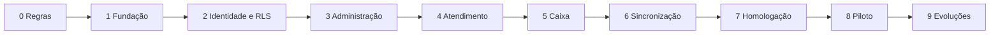

# Comandei — Roadmap de implementação

**Versão:** 1.0 • **Data:** 26/10/2026 • **Status:** plano proposto, com estimativas a calibrar.

Este documento acompanha a [documentação técnica](01-documentacao-tecnica-comandei.md). Os identificadores abaixo podem ser usados como épicos, histórias e casos de teste. “Aceite” significa demonstrar o resultado e guardar evidências; não apenas terminar código.

## 1. Objetivo e premissas de execução

Entregar um MVP SaaS online no qual restaurantes independentes operem comandas por celular/tablet, recebam pelo caixa em PC/tablet e administrem equipe e catálogo com isolamento de dados comprovado.

Planejamento de referência: dois desenvolvedores com atuação em frontend/backend, uma pessoa de produto disponível para decisões e apoio parcial de QA/design/operação. As semanas representam janelas de calendário dessa equipe, sem datas de início contratadas. Não são prazo garantido. Uma pessoa trabalhando sozinha deve recalibrar o plano por esforço e disponibilidade; não basta reutilizar as mesmas semanas.

As fases são sequenciais no caminho crítico. Dentro de cada fase, tarefas independentes de interface e API podem ocorrer em paralelo. Aprovação de comportamento por produto não substitui revisão de segurança, e nenhuma fase dispensa os critérios herdados das anteriores.

### 1.1 Visão de marcos

| Fase | Janela indicativa | Marco / decisão de saída |
|---|---|---|
| 0. Descoberta e contratos | Semana 1 | Regras, protótipos, stack fixada e backlog acordados |
| 1. Fundação e entrega contínua | Semana 2 | Ambientes e pipeline reproduzíveis |
| 2. Identidade e isolamento | Semanas 3–4 | Dois restaurantes isolados e papéis testados |
| 3. Administração e catálogo | Semanas 5–6 | Restaurante configurável sem alterar banco manualmente |
| 4. Atendimento e comandas | Semanas 7–8 | Garçom registra consumo com consistência |
| 5. Caixa e pagamentos manuais | Semanas 9–10 | Consumo recebido e turno fechado sem duplicidade |
| 6. Tempo real e resiliência | Semana 11 | Dispositivos convergem e recuperam falhas |
| 7. Qualidade e operação | Semanas 12–13 | Critérios técnicos para piloto demonstrados |
| 8. Piloto e lançamento controlado | Semanas 14–15 | Operação real acompanhada e decisão de lançamento |
| Reserva | Semanas 16–18 | Correções e imprevistos; não usar para ampliar escopo |
| 9. Evoluções comerciais | Após piloto | Integrações e expansão conforme dados e necessidade |

MVP funcional ao fim da fase 6; MVP apto ao piloto somente após a fase 7. Lançamento comercial depende da fase 8 e dos requisitos de suporte/privacidade/comercial. O prazo de referência é 15 semanas mais 3 de reserva para a equipe descrita.

### 1.2 Dependências



Observabilidade, testes, segurança e acessibilidade começam na fundação e evoluem em todas as fases. A fase 7 consolida evidências, não introduz esses temas pela primeira vez.

## 2. Como usar este roadmap

Cada história deve registrar: ator, problema, resultado, regra aplicável, dependências, comportamento de erro, teste de aceite e evidência. Transformar os IDs em cartões do gerenciador escolhido e estimar em refinamento. Ao concluir uma fase, atualizar versões dos documentos e registrar desvios em ADR.

Modelo de cartão:

```text
ID: CMD-ATD-03
História: Como garçom, quero enviar o carrinho para confirmar o consumo da mesa.
Regra: somente comanda aberta; preço validado no servidor; envio idempotente.
Dependências: CMD-SEC-02, CMD-CAT-02, CMD-ATD-01.
Aceite: repetir a mesma requisição 10 vezes cria exatamente um pedido.
Falhas: preço alterado exige revisão; timeout usa a mesma chave.
Evidência: cenário automatizado, vídeo curto e consulta de verificação.
```

### 2.1 Definição de pronto para iniciar

- Regra e papéis entendidos, exemplos de entrada/saída definidos.
- API/estado de tela identificados, incluindo loading, erro e permissão negada.
- Dependências disponíveis; decisão pendente com dono e prazo.
- Critério de aceite observável e seed/cenário de teste definido.

### 2.2 Definição de concluído

- Código revisado, tipagem/lint e testes pertinentes aprovados.
- Regras aplicadas no servidor e isolamento testado no role real.
- Logs/auditoria necessários presentes, sem credenciais ou dados sensíveis.
- Migração e rollback/compatibilidade considerados quando aplicáveis.
- Interface verificada nos dispositivos afetados, com teclado e estados de erro.
- Contrato/documentação atualizados e evidência anexada ao cartão.
- Entrega demonstrada em staging com dados sintéticos reproduzíveis.

## 3. Fase 0 — Descoberta, regras e protótipo

**Objetivo:** fechar o escopo operacional que orienta modelo, interface e testes.

**Responsáveis:** produto conduz; desenvolvimento valida viabilidade; representante de restaurante valida uso.

| ID | Trabalho |
|---|---|
| CMD-DES-01 | Mapear uma jornada de garçom, caixa, gerente e proprietário, incluindo erros e troca de turno |
| CMD-DES-02 | Definir regras de mesa/comanda, quantidade, adicionais, desconto, serviço, cancelamento e estorno |
| CMD-DES-03 | Prototipar fluxo em 360/768/1366 px e validar operações de toque/teclado |
| CMD-DES-04 | Aprovar matriz de permissões, dia operacional e política de suspensão/limites SaaS |
| CMD-DES-05 | Fixar versões compatíveis, estratégia de conexão, hospedagem, região e estimativa de custo |
| CMD-DES-06 | Escrever ADRs e backlog com cenários financeiros de referência |

**Entregáveis:** mapa de jornada; protótipo navegável; catálogo de regras; matriz de papéis; ADRs iniciais; backlog priorizado; orçamento por categoria, sem depender de preço memorizado de provedor.

**Critérios de aceite:**

- Um representante do restaurante executa no protótipo abertura → pedido → parcial → quitação → encerramento de turno.
- O exemplo de R$ 66,00 da documentação tem cálculo aprovado e tratamento de troco definido.
- Há resposta escrita para: quem cancela item enviado, quem aprova desconto, o que fazer sem internet e se emissão fiscal/impressão é requisito do piloto.
- A equipe registra versões, plano de backup necessário, orçamento autorizado e capacidade de referência a testar.
- Itens fora do MVP estão registrados, com impacto conhecido se virarem requisito.

**Dependências externas:** acesso ao restaurante piloto; decisão de hospedagem e orçamento. Sem aprovação de custos, continuar implementação local e preparar configuração; não provisionar serviços pagos por suposição.

## 4. Fase 1 — Fundação técnica e entrega contínua

**Objetivo:** tornar desenvolvimento e entrega reproduzíveis antes de construir operação.

**Responsáveis:** desenvolvimento; responsável operacional revisa segredos e deploy.

| ID | Trabalho |
|---|---|
| CMD-FND-01 | Criar estrutura web/API/worker, lockfiles, padrões de revisão e variáveis documentadas |
| CMD-FND-02 | Configurar React + Next.js + Tailwind e esqueleto de navegação responsiva |
| CMD-FND-03 | Configurar FastAPI, Pydantic, SQLAlchemy, conexão TLS e tratamento de erros |
| CMD-FND-04 | Preparar Supabase local/staging isolados e migrations como fonte única de schema |
| CMD-FND-05 | Criar CI para lint, tipos, testes, banco temporário e build |
| CMD-FND-06 | Adicionar request ID, logs JSON, telemetria inicial e health checks |
| CMD-FND-07 | Gerar client TypeScript a partir do OpenAPI e detectar divergência em CI |

**Entregáveis:** repositório inicial; guia de setup; `.env.example` sem segredos; pipeline; deploy de staging; health checks e painel inicial.

**Critérios de aceite:**

- Uma pessoa configura o projeto em ambiente limpo seguindo o guia e acessa web/API.
- CI falha em erro de tipo, teste quebrado e mudança de contrato não refletida no client.
- Todas as migrations aplicam em banco vazio; seed cria dados sintéticos.
- API e worker não usam credencial de proprietário no runtime.
- Logs têm correlação entre requisição e banco, sem tokens; staging não compartilha credenciais com produção.
- Existe artefato de build identificável por commit e caminho documentado para voltar à versão anterior.

**Risco tratado:** avançar com infraestrutura que só funciona na máquina de quem a criou.

## 5. Fase 2 — Autenticação, tenants e autorização

**Objetivo:** provar isolamento e controle de acesso antes de armazenar consumo.

**Responsáveis:** backend lidera políticas; frontend implementa sessão; QA revisa matriz negativa.

| ID | Trabalho |
|---|---|
| CMD-SEC-01 | Login, recuperação, sessão SSR, renovação e logout em múltiplas abas |
| CMD-SEC-02 | Verificar JWT no FastAPI por JWKS, issuer/audience e validade |
| CMD-SEC-03 | Modelar tenants, profiles, memberships e entitlements iniciais |
| CMD-SEC-04 | Implementar contexto local por transação, RLS, grants e FKs compostas |
| CMD-SEC-05 | Implementar matriz de ações e consulta atual do vínculo |
| CMD-SEC-06 | Convites de uso único com expiração e gestão segura de papéis |
| CMD-SEC-07 | Separar administração da plataforma e implementar provisionamento assistido |
| CMD-SEC-08 | Automatizar testes A/B, pool reutilizado e ausência de contexto |

**Entregáveis:** autenticação utilizável; seleção de tenant; migrations/policies; suíte de isolamento; fluxo de convites; relatório de revisão de segurança.

**Critérios de aceite:**

- Usuário de A não acessa B por troca de UUID, URL, body, exportação ou relacionamento de FK.
- Usuário de A/B só consulta o tenant selecionado na operação; troca limpa cache e canais.
- JWT adulterado, expirado, de outro projeto ou de algoritmo não permitido retorna 401.
- Remover vínculo impede a próxima operação da API, inclusive com token ainda válido.
- Reutilizar a mesma conexão após A ou rollback não revela A a B.
- Tentativa de elevar papel via `user_metadata`, payload ou chamada direta falha.
- Gerente não cria proprietário; último proprietário ativo não pode ser removido.
- Testes rodam como runtime sem `BYPASSRLS`, e nenhum dado de negócio fica aberto a `anon`.

**Bloqueio de saída:** qualquer vazamento entre tenants ou credencial privilegiada exposta impede iniciar piloto e precisa correção imediata.

## 6. Fase 3 — Administração, mesas e catálogo

**Objetivo:** permitir configurar o restaurante por interface, preservando histórico de preços.

**Responsáveis:** frontend/backend com validação de produto.

| ID | Trabalho |
|---|---|
| CMD-CAT-01 | CRUD de mesas, categorias, ordenação e desativação |
| CMD-CAT-02 | Produtos, preço em centavos, unidade, disponibilidade e versão |
| CMD-CAT-03 | Grupos/adicionais com mínimo, máximo e validação de seleção |
| CMD-CAT-04 | Interface administrativa, busca e paginação com escopo de tenant |
| CMD-CAT-05 | Configurar serviço, limite de desconto, fuso e corte de dia operacional |
| CMD-CAT-06 | Registrar auditoria e aplicar limites SaaS no servidor |

**Entregáveis:** área administrativa; catálogo consumível pela interface do garçom; seed de restaurante completo; testes de validação e permissão.

**Critérios de aceite:**

- Proprietário cria restaurante operacional com mesas e cardápio sem editar banco.
- Garçom/caixa não alteram preços por chamada direta à API.
- Produto indisponível não pode ser enviado mesmo se o browser mantiver cache antigo.
- Adicional de outro tenant ou não vinculado ao produto é rejeitado.
- Valores inválidos, quantidade fracionada em produto unitário e seleção acima do limite falham com erro compreensível.
- Desativar produto preserva referências/histórico; alteração de preço incrementa versão.
- Formulários funcionam nas três larguras previstas e com navegação por teclado.

## 7. Fase 4 — Atendimento, comandas e pedidos

**Objetivo:** executar o trabalho do garçom com confirmação consistente no servidor.

**Responsáveis:** frontend conduz fluxo; backend garante transações; QA valida corrida e repetição.

| ID | Trabalho |
|---|---|
| CMD-ATD-01 | Abrir comanda de mesa/balcão com unicidade de mesa ativa |
| CMD-ATD-02 | Carrinho por usuário/tenant, quantidades, adicionais e revisão |
| CMD-ATD-03 | Enviar atomicamente com idempotência, snapshots e validação de preço |
| CMD-ATD-04 | Implementar estados de item, pedido derivado e histórico |
| CMD-ATD-05 | Solicitação/aprovação de cancelamento com motivo e autoria |
| CMD-ATD-06 | Controle de versão e conflito ao iniciar fechamento durante envio |
| CMD-ATD-07 | Gravar auditoria e outbox na transação de negócio |

**Entregáveis:** interface do garçom; endpoints de comandas/pedidos; máquina de estados; testes concorrentes; mecanismo de outbox persistido, ainda sem depender da publicação para funcionar.

**Critérios de aceite:**

- Dois garçons podem lançar pedidos distintos na mesma comanda sem perder dados; conflito é explicitamente resolvido quando a versão exigir revisão.
- Dez repetições com a mesma chave criam um pedido; mesma chave com conteúdo diferente retorna 409.
- Duas aberturas simultâneas de mesa criam apenas uma comanda ativa.
- Preço alterado depois da revisão exige confirmação do novo preço.
- Falha antes do commit não deixa item, total ou evento parcial; timeout depois do commit recupera a resposta pela mesma chave.
- Pedido enviado é distinto visualmente de rascunho; nenhum rascunho é apresentado como consumo confirmado.
- Item cancelado preserva histórico e ator/aprovador; papel sem permissão não executa cancelamento.

**Demonstração de marco:** abrir mesa no celular, lançar dois pedidos e conferir detalhes em tablet/PC por reconsulta manual. Atualização automática será homologada na fase 6.

## 8. Fase 5 — Pré-conta, pagamentos e turnos

**Objetivo:** fechar o ciclo financeiro do MVP com recebimentos manuais e rastreabilidade.

**Responsáveis:** backend lidera invariantes; frontend implementa caixa; produto valida regras monetárias.

| ID | Trabalho |
|---|---|
| CMD-CXA-01 | Cálculo central, descontos aprovados, serviço opcional e pré-conta |
| CMD-CXA-02 | Congelar liquidação e impedir novos itens após início do fechamento |
| CMD-CXA-03 | Registrar parciais em dinheiro, cartão e Pix com idempotência e lock |
| CMD-CXA-04 | Calcular troco, saldo e encerrar somente com saldo zero |
| CMD-CXA-05 | Estornos compensatórios, limites estornáveis e aprovação gerencial |
| CMD-CXA-06 | Abrir turno, suprimento, sangria, contagem, diferença e encerramento |
| CMD-CXA-07 | Relatório por método/dia operacional e exportação CSV privada |
| CMD-CXA-08 | Implementar reabertura apenas sem recebimentos e trilha de liquidações |

**Entregáveis:** área do caixa; motor de cálculo; ledger operacional; relatório diário; recibo não fiscal; suíte financeira e de concorrência.

**Critérios de aceite:**

- Exemplo de subtotal 64, desconto 4, serviço 6 e total 66 produz exatamente os valores documentados.
- Recebimentos de 40 e 26 quitam a comanda; a API rejeita excesso ou fechamento com saldo.
- Entrega de 50 para parcela de 40 gera troco de 10, com receita de 40.
- Duas requisições simultâneas de quitação não confirmam 132 para conta de 66.
- Fechamento versus novo pedido é serializado; não existe consumo aceito fora da liquidação congelada.
- Cartão/Pix não aumentam caixa físico; sangria e suprimento explicam o saldo esperado.
- Estorno não altera recebimento original nem turno fechado; repetição não excede o valor estornável.
- Turno fechando versus pagamento não cria movimento posterior ao fechamento.
- Relatório da madrugada respeita fuso/corte operacional; CSV não revela outro tenant e neutraliza fórmulas.

**Limite explícito do marco:** métodos cartão/Pix são registros manuais de recebimento externo. Integração bancária automática depende da fase 9.

## 9. Fase 6 — Tempo real, reconexão e falhas

**Objetivo:** manter dispositivos convergentes sem depender de WebSocket para consistência financeira.

**Responsáveis:** backend/worker e frontend; QA executa cenários com rede interrompida.

| ID | Trabalho |
|---|---|
| CMD-RT-01 | Worker outbox com lease, retry, backoff e fila de falhas |
| CMD-RT-02 | Broadcast privado por tenant e policy de recepção por membership |
| CMD-RT-03 | Invalidação de consultas, deduplicação e versão de agregado |
| CMD-RT-04 | Snapshot inicial seguro, reconexão e retorno do segundo plano |
| CMD-RT-05 | Polling de contingência e indicação de atualização degradada |
| CMD-RT-06 | Bloqueio de escrita offline e resolução de resultado desconhecido |
| CMD-RT-07 | Telemetria de atraso, backlog e falha de canal |

**Entregáveis:** sincronização entre dispositivos; fallback; painel de outbox; runbook de reprocessamento; evidência de testes de canal e falhas.

**Critérios de aceite:**

- Pedido confirmado no celular aparece no caixa em p95 ≤ 2 s nas condições de homologação registradas.
- Cliente de A não entra no canal de B; cliente comum não publica aviso de negócio.
- Avisos não contêm valores, nomes de clientes ou observações; leitura efetiva sempre passa pela API.
- Crash do worker antes/depois de publicar não perde atualização de negócio nem duplica pedido/pagamento.
- Eventos duplicados ou fora de ordem não fazem a tela retroceder.
- Reconexão busca estado atual mesmo que todos os avisos durante a queda tenham sido perdidos.
- Falha só do Realtime ativa polling e converge em até 20 s nas condições testadas.
- Sem rede, interface não confirma pedido nem pagamento; reenvio usa chave original e exige revisão quando necessário.
- Limitação de revogação do canal está demonstrada; API bloqueia membro desativado na próxima consulta.

## 10. Fase 7 — Homologação, segurança e preparação operacional

**Objetivo:** provar que o MVP pode operar com suporte e recuperação, antes de expor turno real.

**Responsáveis:** QA coordena evidências; desenvolvimento corrige; operação valida restore e alertas.

| ID | Trabalho |
|---|---|
| CMD-OPS-01 | Consolidar E2E e acessibilidade nos três dispositivos |
| CMD-OPS-02 | Executar testes de carga, medir SQL/pool/locks e corrigir gargalos |
| CMD-OPS-03 | Revisar JWT, RLS, grants, funções, views, Storage e segredos |
| CMD-OPS-04 | Homologar pipeline, migrations compatíveis e rollback da aplicação |
| CMD-OPS-05 | Habilitar backup/PITR conforme meta e executar restore isolado |
| CMD-OPS-06 | Concluir painéis, alertas, plantão e runbooks |
| CMD-OPS-07 | Validar políticas de retenção, contratos, suporte e limites comerciais |
| CMD-OPS-08 | Preparar onboarding assistido, treinamento e dados do piloto |

**Entregáveis:** relatório de carga; relatório de segurança; checklist de liberação; runbooks; gravação/registro do restore; manual rápido de operação; documentação de suporte.

**Critérios de aceite:**

- Carga de referência acordada por 30 min atende metas p95 e erros da documentação, sem violar saldo/tenant.
- Nenhuma falha conhecida crítica/alta de isolamento, autenticação ou integridade permanece aberta.
- Fluxo completo passa em celular, tablet e PC; nenhum bloqueio de acessibilidade impede ação essencial.
- Restore comprova RPO ≤ 15 min e RTO ≤ 4 h, ou a meta é renegociada e registrada antes do piloto; não declarar atendimento apenas por contratar backup.
- Rollback da aplicação anterior funciona com schema expandido; nenhuma migration depende de deploy simultâneo perfeito.
- Alertas de indisponibilidade/backlog/backup foram disparados em teste e chegaram ao responsável definido.
- Produção usa segredos separados e processo de migration único; não existe credencial privilegiada no bundle web.
- Restaurante conhece limites de internet, pagamentos manuais e recibo não fiscal, e valida que o piloto cabe nesses limites.

**Bloqueio de saída:** acesso cruzado, duplicidade financeira, ausência de recuperação viável ou ausência de responsável por incidente impede piloto.

## 11. Fase 8 — Piloto e lançamento controlado

**Objetivo:** validar a operação real, treinar equipe e observar comportamento em horários de pico.

**Responsáveis:** produto e responsável do restaurante; desenvolvimento/operação em acompanhamento.

| ID | Trabalho |
|---|---|
| CMD-PIL-01 | Configurar um restaurante, conferir cardápio/preços e cadastrar usuários individuais |
| CMD-PIL-02 | Treinar garçom, caixa e gerente com cenário de venda/cancelamento/estorno |
| CMD-PIL-03 | Operar em janela reduzida com procedimento de contingência conhecido |
| CMD-PIL-04 | Acompanhar pelo menos cinco dias de operação, incluindo dois períodos de pico |
| CMD-PIL-05 | Conferir diariamente comandas, recebimentos, gaveta e meios externos |
| CMD-PIL-06 | Priorizar problemas observados e validar correções sem ampliar escopo |
| CMD-PIL-07 | Decidir lançamento gradual e preparar segundo tenant |

**Entregáveis:** relatório do piloto; lista de problemas e resoluções; feedback por perfil; treinamento; decisão documentada de lançamento.

**Critérios de aceite:**

- Zero divergência financeira sem explicação e zero acesso cruzado; qualquer ocorrência abre incidente e suspende expansão até resolução.
- Pelo menos cinco dias e dois picos concluídos com logs e conciliação registrados.
- Pelo menos um ciclo completo de abertura/fechamento de turno executado sem auxílio do desenvolvedor.
- Equipe resolve preço desatualizado, timeout e queda de conexão usando orientações do produto.
- Metas de usabilidade e erro definidas na fase 0 são medidas; problemas bloqueadores estão corrigidos.
- Segundo restaurante é provisionado sem alteração manual de código ou acesso aos dados do primeiro.
- Produto, restaurante e operação registram decisão de seguir, prolongar piloto ou corrigir antes de expandir.

Contingência durante indisponibilidade: registrar consumo externamente pelo procedimento acordado do restaurante; após retorno, reconciliar com cuidado os comandos de resultado desconhecido antes de lançar novamente. O Comandei MVP não garante operação offline.

## 12. Fase 9 — Evolução após o piloto

Estas frentes são opcionais e dependem de priorização. Não estão contidas no prazo do MVP.

| Frente | Estimativa inicial | Dependências | Entregáveis e aceite |
|---|---|---|---|
| Assinatura SaaS automática | 2–3 semanas | Provedor, planos e regras comerciais | Checkout, webhooks, reconciliação, entitlements; eventos duplicados/fora de ordem não concedem plano incorreto e suspensão preserva contas em andamento |
| Pix/cartão integrados | 3–5 semanas | Provedor, recebedor por tenant e homologação | Intenções, webhook assinado, estorno e reconciliação; valor/moeda/tenant divergentes não quitam comanda; timeout não duplica cobrança |
| Cozinha e bar | 2–3 semanas | Estados de itens e validação de operação | Filas por setor, tempos e permissões; preparo não perde itens e entrega mantém histórico |
| Impressão | 2–4 semanas | Hardware, rede e estratégia de agente | Fila, retry e confirmação; reimpressão identificada sem duplicar pedido financeiro |
| Fiscal | 4–8+ semanas | Escopo fiscal, provedor e requisitos aplicáveis | Integração homologada, contingência e reconciliação; estimativa revisada por jurisdição/provedor |
| Divisão/transferência de comanda | 2–4 semanas | Modelo de alocação e regras financeiras | Rateio determinístico, locks e auditoria; centavos e saldo preservados em operações concorrentes |
| Filiais/grupos | 3–5 semanas | Modelo de grupo e autorização de escopo | Visão consolidada autorizada sem enfraquecer isolamento por estabelecimento |
| Escrita offline | Descoberta de 1–2 semanas antes de estimar build | Regras de conflito, segurança local e operação | Prova técnica com sincronização e prevenção de duplicidade; não prometer offline financeiro antes dessa validação |

## 13. Matriz de rastreabilidade

| Requisito | Histórias principais | Evidência de aceite |
|---|---|---|
| Interface responsiva e administração | DES-03, CAT-04, OPS-01 | Testes 360/768/1366 px, toque e teclado |
| React + Next.js + Tailwind | FND-02 | Build web e revisão do repositório |
| FastAPI e contrato | FND-03, FND-07 | OpenAPI/client e testes HTTP |
| Supabase Auth | SEC-01, SEC-02 | Login, refresh, JWT inválido e logout |
| Multi-tenant/RLS/autorização | SEC-03 a SEC-08 | Suíte A/B, grants e pool reutilizado |
| Catálogo/modelagem | CAT-01 a CAT-06 | Migrations, constraints e seed |
| Pedidos e concorrência | ATD-01 a ATD-07 | Corridas, snapshots, idempotência e rollback |
| Pagamentos e caixa | CXA-01 a CXA-08 | Fixtures monetárias e corridas de quitação |
| Realtime e reconexão | RT-01 a RT-07 | Vídeos/medidas e falhas simuladas |
| Observabilidade | FND-06, OPS-06 | Painéis, traces e alertas disparados |
| Testes e qualidade | Todas; OPS-01 a OPS-03 | Relatórios CI/E2E/carga/segurança |
| Deploy e recuperação | FND-05, OPS-04, OPS-05 | Pipeline, rollback e restore cronometrado |
| Operação SaaS | SEC-07, CAT-06, PIL-07 | Onboarding de dois tenants e limites reais |

Na matriz, os IDs abreviados herdam o prefixo `CMD-`.

## 14. Riscos, resposta e gatilhos

| Risco | Prevenção | Gatilho / ação |
|---|---|---|
| Vazamento entre restaurantes | RLS, FK composta, papéis mínimos e testes negativos | Qualquer evidência: interromper expansão, conter acesso e investigar |
| Pagamento duplicado | Lock, idempotência e referências permanentes | Qualquer divergência: bloquear fluxo afetado e reconciliar |
| Internet instável | Estado explícito, snapshot e contingência treinada | Falhas recorrentes no piloto: rever rede/viabilidade antes de escalar |
| Backlog Realtime | Outbox, retry, métricas e polling | Idade > 30 s: investigar worker/provedor e manter reconsulta segura |
| Banco/pool saturados | Limites, índices, carga e observação | Uso persistente > 80%: reduzir concorrência e ajustar capacidade |
| Escopo fiscal/hardware inesperado | Validar na fase 0 | Se obrigatório para operar: replanejar piloto e dependências |
| Regra financeira ambígua | Exemplos aprovados e fixtures | Divergência de interpretação: parar história dependente e registrar decisão |
| Prazo comprimido | Reserva e escopo claro | Estouro: reestimar, cortar evolução opcional; preservar segurança/financeiro |
| Restore não atende meta | Exercício antes do piloto | Falha: corrigir plano/procedimento ou renegociar meta explicitamente |

## 15. Operação e runbooks mínimos

Cada runbook contém: sinal do problema, verificação, responsável, ação reversível, checagem final e comunicação necessária.

1. **API indisponível:** verificar versão/health/dependências; restaurar versão anterior quando compatível; validar leitura e envio idempotente.
2. **Realtime/outbox atrasados:** confirmar HTTP; habilitar indicação de polling; recuperar worker e reprocessar lote sem repetir efeito financeiro.
3. **Timeout de pagamento:** identificar chave e consultar resultado; nunca criar novo registro até resolver o estado anterior.
4. **Divergência de caixa:** preservar turno/lançamentos; comparar dinheiro, recebimentos e movimentos; corrigir por compensação auditada.
5. **Suspeita de acesso cruzado:** conter credencial/rota, preservar evidências, avaliar alcance e seguir processo de incidente definido.
6. **Recuperação de banco:** bloquear escritas, restaurar isolado, validar dados/RLS, reconciliar pagamentos e liberar com responsável.
7. **Tenant suspenso ou usuário bloqueado:** verificar status atual e permissões; orientar encerramento operacional conforme política, sem editar histórico.

## 16. Checklist de liberação

- [ ] Regras de negócio e exclusões do MVP aceitas pelo restaurante piloto.
- [ ] Suíte de isolamento aprovada com role real de execução.
- [ ] Cenários monetários e concorrentes aprovados, sem duplicação ou saldo inválido.
- [ ] Interface verificada nos três formatos, incluindo erro e perda de conexão.
- [ ] Canais privados e reconsulta autorizada demonstrados.
- [ ] Segredos, grants, funções, views, cookies/cache e exportações revisados.
- [ ] CI, migrations, deploy e rollback exercitados.
- [ ] Backup/restore e metas de recuperação comprovados ou formalmente ajustados.
- [ ] Painéis, alertas e responsável operacional ativos.
- [ ] Política de retenção, suporte e documentação comercial definidas.
- [ ] Equipe treinada e contingência conhecida.
- [ ] Piloto conciliado e decisão de expansão registrada.

## 17. Primeira iteração executável

Iniciar pela fase 0 e reservar o primeiro ciclo técnico para uma fatia completa: login → selecionar tenant → consultar uma mesa autorizada. Antes de adicionar pedidos, demonstrar que usuário de A não lê a mesa de B pela API nem pelo banco sob o role runtime. Essa evidência sustenta as próximas entregas e evita construir o fluxo operacional sobre isolamento ainda não comprovado.
